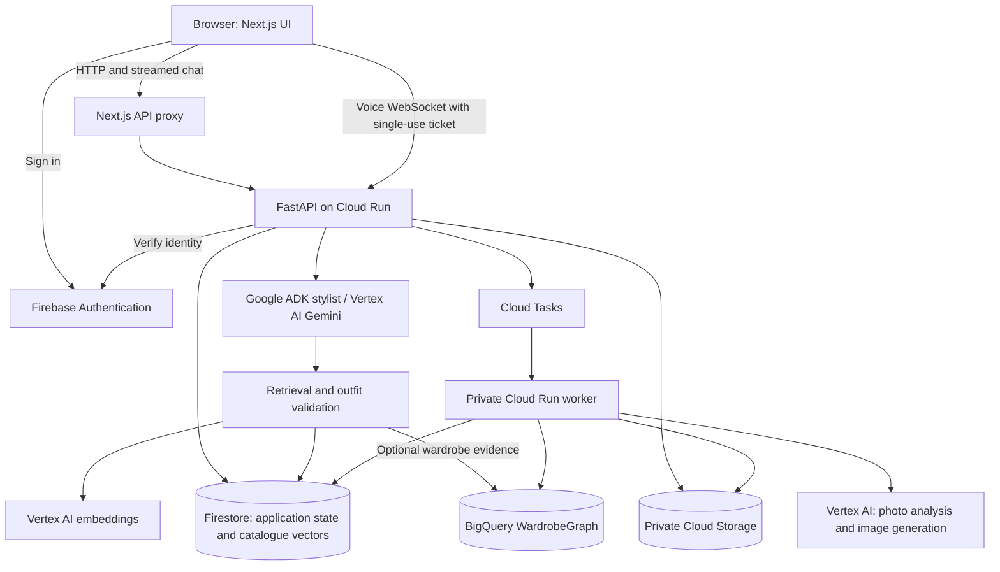

# Flairify

**This is the frontend repository. The API, worker, and technical documentation are in [Flairify-Backend](https://github.com/samwin-steve/Flairify-Backend). Both repositories make up this submission; the submitted link points here.**

[Live app](https://flairify-web-7kxckvikva-uc.a.run.app) · [API docs](https://flairify-api-7kxckvikva-uc.a.run.app/docs) · [Architecture](https://github.com/samwin-steve/Flairify-Backend/blob/main/docs/ARCHITECTURE.md)

Flairify is a clothing shopping app that recommends outfits based on an occasion, budget, saved sizes, and available stock. Shoppers can browse without photos, optionally include clothes they already own, refine recommendations through text or voice, and generate a 2D preview using a reference photo. Sellers can add listings and manage their inventory.

## Try it

1. Open the app and choose **Browse as guest** for a credential-free demo, or sign in to use configured Google model features.
2. Save your department, clothing and shoe sizes, preferred store, and budget. Photos are optional.
3. Browse **Inventory**, or ask the **Stylist** for an outfit, such as “A summer party outfit under ₹5,000.” Refine a look or save it for later.
4. Optionally add and confirm wardrobe pieces, then choose **With my wardrobe**. Signed-in users can select garments and use **See it on me** after supplying a reference photo and photo-processing consent.
5. Review a purchase through **Buy** and find the saved record in **My Orders**. Checkout does not take payment or arrange delivery.

The app's **Behind the scenes** view walks through the recommendation architecture. It is an interactive illustration, not a live request trace.

## Architecture

The frontend is a Next.js 16 / React 19 application written in TypeScript. FastAPI owns authentication checks, recommendations, inventory validation, and background jobs. The diagram summarizes the [backend architecture documentation](https://github.com/samwin-steve/Flairify-Backend/blob/main/docs/ARCHITECTURE.md).



- **Text recommendations:** the browser sends authenticated requests through `/api/chat/stream`. The backend retrieves catalogue candidates, checks complete outfits against sizes, stock, and the combined price of new pieces, then streams the explanation and returns structured outfit cards. Product facts come from backend records.
- **Wardrobe pairing:** only confirmed garments are eligible. BigQuery adds evidence from previously checked outfits; Firestore remains the source for current prices and availability.
- **Photos and previews:** the API queues work; the worker processes it and saves private results. The UI polls job status and displays completed previews in Fitting Room.
- **Voice:** microphone audio connects directly to the backend using a short-lived ticket. Gemini Live supplies spoken replies and transcripts. Flairify stores transcripts, not audio.
- **Local mode:** SQLite, local media, and an in-process job executor replace cloud storage and queues. Guest recommendations use deterministic rules; they do not call paid models.

## Run locally

Requires **Node.js 24.12+**, **Python 3.12–3.14**, and **uv**. Clone both repositories into the same parent directory:

```sh
git clone https://github.com/samwin-steve/Flairify-Frontend.git
git clone https://github.com/samwin-steve/Flairify-Backend.git
```

Start the backend in one terminal:

```sh
cd Flairify-Backend
cp .env.example .env
uv sync --locked
uv run uvicorn app.main:app --reload --port 8000
```

Start the frontend in another terminal:

```sh
cd Flairify-Frontend
cp .env.example .env.local
npm ci
npm run dev
```

Open [localhost:3000](http://localhost:3000) and choose **Browse as guest**. Backend API documentation is at [localhost:8000/docs](http://localhost:8000/docs). No cloud credentials or separate worker process are needed for this local demo.

### Configuration

| Variable in `.env.local` | Purpose |
| --- | --- |
| `BACKEND_URL` | Server-side API origin; defaults to `http://127.0.0.1:8000`. |
| `FIREBASE_API_KEY` | Firebase web app identifier for real account sign-in. |
| `FIREBASE_AUTH_DOMAIN` | Firebase authentication domain. |
| `FIREBASE_PROJECT_ID` | Firebase project ID. |
| `FIREBASE_APP_ID` | Firebase web app ID. |

Leave Firebase fields as supplied for guest mode. To enable sign-in, supply your Firebase web app configuration and configure the backend for the same project. The `/config` route exposes these public identifiers at runtime. Cloud credentials remain on the backend.

Live chat, photo analysis, image generation, and voice require backend model configuration, Google Cloud access, and a signed-in account. See [integration setup](https://github.com/samwin-steve/Flairify-Backend/blob/main/docs/INTEGRATIONS.md) and [voice setup](https://github.com/samwin-steve/Flairify-Backend/blob/main/docs/VOICE_STYLIST.md).

## Where the code lives

| Path | Responsibility |
| --- | --- |
| [`src/app/page.tsx`](src/app/page.tsx) | Application entry point. |
| [`src/components/flairify.tsx`](src/components/flairify.tsx) | Main app shell, authentication, navigation, conversations, and saved looks. |
| [`src/components/onboarding.tsx`](src/components/onboarding.tsx) | Shopping preferences and photo/wardrobe setup. |
| [`src/components/inventory.tsx`](src/components/inventory.tsx), [`checkout.tsx`](src/components/checkout.tsx) | Catalogue browsing and reviewed checkout. |
| [`src/components/fitting-room.tsx`](src/components/fitting-room.tsx) | Reference photos, generation jobs, and completed previews. |
| [`src/components/admin.tsx`](src/components/admin.tsx) | Seller Studio, listings, and seller access management. |
| [`src/components/voice-conversation.tsx`](src/components/voice-conversation.tsx) | Voice controls and transcript presentation. |
| [`src/lib/api.ts`](src/lib/api.ts), [`chat-stream.ts`](src/lib/chat-stream.ts) | Authenticated API calls and streamed chat parsing. |
| [`src/lib/use-voice-stylist.ts`](src/lib/use-voice-stylist.ts), [`voice-audio.ts`](src/lib/voice-audio.ts) | Voice session lifecycle and browser audio handling. |
| [`src/components/media.tsx`](src/components/media.tsx), [`src/lib/media-cache.ts`](src/lib/media-cache.ts) | Authorized image loading and account-scoped caching. |
| [`src/app/api/[...path]/route.ts`](src/app/api/%5B...path%5D/route.ts) | Server-side proxy for API requests, streams, and private media. |
| [`src/components/behind-the-scenes.tsx`](src/components/behind-the-scenes.tsx) | Interactive architecture walkthrough. |
| [`src/app/globals.css`](src/app/globals.css), [`src/components/ui/`](src/components/ui/) | Styling and shared UI controls. |
| [`public/`](public/) | Sample images, audio worklet, model assets, and image credits. |
| [`tests/`](tests/) | Vitest logic tests and Playwright browser journeys. |
| [`Dockerfile`](Dockerfile), [`cloudbuild.yaml`](cloudbuild.yaml) | Production image and Cloud Run build/deployment. |

TanStack Query manages server state and polling. React Hook Form and Zod handle forms; Radix supplies dialog behavior. Most application views live inside the main app shell rather than separate page routes.

## Checks

Run from this repository:

```sh
npm run typecheck
npm test
npm run build
npx playwright install chromium
# Keep the frontend and backend running for browser tests.
npm run test:e2e
```

Playwright runs desktop and Pixel 7 emulation, covering onboarding, chat, previews, checkout, voice controls, and accessibility checks. Some scenarios use fixtures or mocks; passing them does not establish live model quality. Local seller tests require `ENABLE_DEMO_ADMIN=true` and `DEMO_ADMIN_KEY=test-admin-key` in the backend test environment. Recorded live-service checks are in the backend's [verification log](https://github.com/samwin-steve/Flairify-Backend/blob/main/docs/VERIFICATION.md).

## Deployment

The Dockerfile builds a standalone Next.js application and runs it as a non-root user. `cloudbuild.yaml` builds and deploys `flairify-web` to Cloud Run; the backend repository deploys `flairify-api` and its private worker. Deploy the backend first and set `BACKEND_URL` to its origin. The project's deployment configuration uses `data-workshops` in `us-central1`; adapt it for another project using the [deployment guide](https://github.com/samwin-steve/Flairify-Backend/blob/main/docs/DEPLOYMENT.md).

## Scope and further reading

Sample catalogue prices, sizes, and stock are simulated; seller listings retain supplied facts. Generated previews are style visualizations, not measurements or fit predictions. The 3D/AR view uses a sample mannequin, not a reconstruction of the shopper. Google Photos needs separate authorization; account sign-in does not grant photo access.

- [Recommendation retrieval and streaming](https://github.com/samwin-steve/Flairify-Backend/blob/main/docs/SEMANTIC_RAG.md)
- [Known limitations](https://github.com/samwin-steve/Flairify-Backend/blob/main/docs/LIMITATIONS.md)
- [Demo walkthrough](https://github.com/samwin-steve/Flairify-Backend/blob/main/docs/DEMO_SCRIPT.md)
- [Catalogue provenance](CATALOGUE.md), [image credits](public/image-credits.json), and [third-party notices](THIRD_PARTY.md)
- [License](LICENSE)
